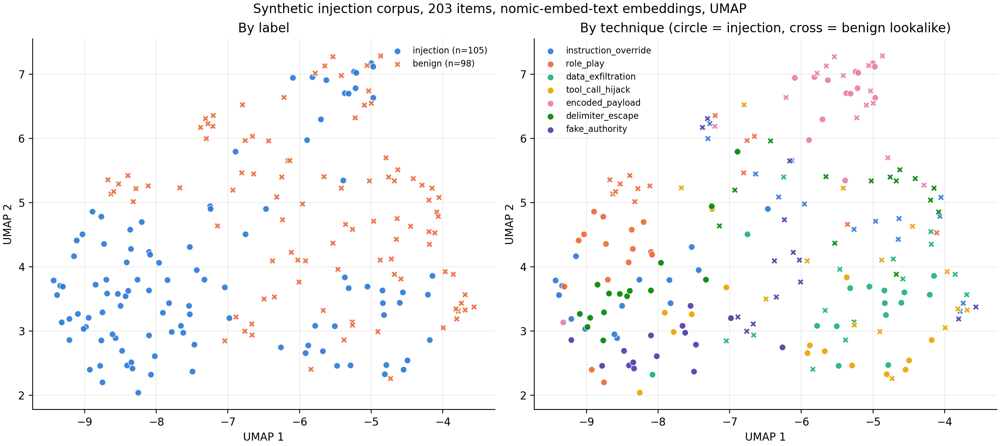

# agent-hook-guards

Small, tested guards and examples for AI coding agents. They stop an agent touching protected paths, writing to a read-only remote host, committing secrets, or pushing to the wrong remote, and they include a labelled prompt-injection corpus with a simple tripwire. Every guard ships with cases that show it blocking a bad action and allowing a safe one, plus a mutation check that proves the tests can fail.

> **Status.** The v0.1 guards (protected paths, git guard) are the stable core: tested, but early and not widely used. The v0.2 read-only remote guard and the v0.3 injection corpus, tripwire, and embedding map are **prototypes**, included from version 0.3.0. Expect rough edges and breaking changes in all of it.
>
> **Threat model in one line.** These guards are coordination for a cooperative but fallible agent. They are **not a sandbox** and **not a security boundary**. See [Threat model](#threat-model).

## What v0.1 does not stop

- A script written to disk and then run, or an interpreter that builds a path at run time (`python3 -c` with string joins).
- Obfuscated commands, such as base64 or a variable set in an earlier call.
- Anything that does not pass through the hook, such as other processes, other tools, or a fresh clone without the git hooks.
- `git commit --no-verify`, secrets with no recognisable shape, and anything already in history.
- An agent that edits the hook config or the Claude Code settings.

The [Threat model](#threat-model) has the full table.

## Why

Agent permission rules are usually scoped to tools. A rule that denies the Read tool on a folder does not stop `cat`, a redirect, a glob, a symlink, or `grep -R` reaching the same files through the shell. A `PreToolUse` hook sees every tool call before it runs, so one guard can apply one rule to all of them.

Git is the other common leak. An agent that is told "commit your work" will commit whatever is staged. A git hook is the last check before content enters history.

## What is in the repository

| Part | Release | What it does |
|---|---|---|
| `agent_hook_guards/protected_paths.py` | v0.1 | A Claude Code `PreToolUse` hook. Blocks file tools and shell commands whose path operands reach a protected area. |
| `git-hooks/git-guard.sh` | v0.1 | pre-commit, commit-msg, and pre-push hooks. Blocks secret-shaped content and file names, optional private terms, and pushes to unlisted remotes. |
| `agent_hook_guards/_hook.py`, `_config.py`, `_shell.py` | v0.1 | Shared runtime, config loader, and shell tokeniser. Standard library only. |
| `agent_hook_guards/readonly_remote.py` | v0.2 prototype | A `PreToolUse` hook. Allows `ssh` to a configured host only with an allowlisted read command, and refuses copies, tunnels, and writes. |
| `corpus/injection/` | v0.3 prototype | 203 synthetic, labelled prompt-injection items and hard negatives, with a schema, a validator, and a fixed split. |
| `agent_hook_guards/injection_tripwire.py` | v0.3 prototype | A standard library tripwire that flags injection-like text. It never blocks or rewrites. |
| `examples/injection_map/embed_map.py` | v0.3 prototype | Embeds the corpus with a local Ollama model and plots a PCA or UMAP map. Needs numpy, scikit-learn, and matplotlib. |

Python 3.9 or later. The guards and the tripwire use no third-party packages. Only the embedding map example does. The git guard needs bash 3.2 or later, git, and the standard `grep`, `sed`, `awk`, `tr`, and `mktemp`.

## Quick start

```sh
git clone <this repository> /opt/agent-hook-guards
mkdir -p ~/.config/agent-hook-guards
cp /opt/agent-hook-guards/examples/config.example.json ~/.config/agent-hook-guards/config.json
# try it with the example config (exit 2 means blocked), then edit the config
printf '%s' '{"tool_name":"Read","tool_input":{"file_path":"/mnt/protected-share/a.txt"}}' \
  | PYTHONPATH=/opt/agent-hook-guards python3 -m agent_hook_guards.protected_paths
echo "exit $?"
```

`/opt/agent-hook-guards` is a placeholder. Use wherever you cloned the repository.

## Configuration

The protected-paths guard reads JSON from `$AGENT_GUARDS_CONFIG`, else `~/.config/agent-hook-guards/config.json`.

```json
{
  "protected_prefixes": ["/mnt/protected-share"],
  "protected_names": ["SharedData"]
}
```

| Key | Meaning |
|---|---|
| `protected_prefixes` | Absolute paths. Anything that resolves under one of them is protected. `~` is expanded. |
| `protected_names` | Plain names. A path component with this name is protected anywhere. Use it for symlinks into the protected area. |

A missing, unreadable, or invalid config blocks every call until it is fixed.

The read-only remote guard reads its own object, `readonly_remote`, from the same file. The other guards ignore it.

```json
{
  "readonly_remote": {
    "hosts": ["example-cluster", "*.cluster.example"],
    "extra_read_commands": ["squeue", "sinfo"],
    "forbidden_prefixes": ["/mnt/protected-share"],
    "forbidden_names": ["SharedData"],
    "remote_home": "/srv/agent"
  }
}
```

| Key | Meaning |
|---|---|
| `hosts` | Required. Host names or `fnmatch` patterns, matched without case. List every ssh alias too, because the guard cannot read your ssh config. |
| `extra_read_commands` | Optional. Command words added to the built-in read allowlist. Shells, interpreters, `sudo`, `env`, `xargs`, `sed`, `awk`, `rm`, `cp`, `mv`, and similar are refused even if listed. |
| `forbidden_prefixes` | Optional. Absolute remote paths that may not be read, even with an allowed command. |
| `forbidden_names` | Optional. Path components, such as a symlink into a forbidden area, that may not appear anywhere in a remote path. |
| `remote_home` | Optional. The remote home directory. It resolves `~` and relative paths. Without it, a recursive command on a relative path is refused when `forbidden_prefixes` is set. |

The git guard reads `git config` keys, so no remote URL is ever written into a repository.

| Key | Meaning |
|---|---|
| `agent-hook-guards.denylist` | Optional file of private terms, one per line, matched without case. Set but unreadable means commits are refused. |
| `agent-hook-guards.allowedRemote` | Multi-valued. Exact URLs that pushes may go to. |
| `agent-hook-guards.allowOwnOrigin` | `true` allows pushes to this repository's own `origin` URL, if it also matches `ownerRegex`. |
| `agent-hook-guards.ownerRegex` | Extended regular expression that the `origin` URL must match. |

With nothing configured, every push is refused.

## Wiring into Claude Code

Add a `PreToolUse` hook to a settings file. The full example is [`examples/settings.example.json`](examples/settings.example.json).

```json
{
  "hooks": {
    "PreToolUse": [
      {
        "matcher": "*",
        "hooks": [
          {
            "type": "command",
            "command": "sh -c 'G=/opt/agent-hook-guards; [ -f \"$G/agent_hook_guards/protected_paths.py\" ] || { echo \"agent-hook-guards: guard missing, refusing\" >&2; exit 2; }; PYTHONPATH=\"$G\" python3 -m agent_hook_guards.protected_paths; [ $? -eq 0 ] || exit 2'"
          }
        ]
      }
    ]
  }
}
```

The example also registers the read-only remote guard as a second hook in the same entry, with the same wrapper. Remove it if you do not use that guard.

The `sh -c` wrapper matters. If the guard file is missing, or Python cannot start, the wrapper still exits 2, so a broken install blocks instead of silently allowing. A test runs this exact wrapper.

Hook contract the guards rely on:

- The hook gets one JSON object on stdin with `hook_event_name`, `tool_name`, and `tool_input`.
- Exit 0 allows. Exit 2 blocks, and stderr is shown to the model.
- [Likely] Other exit codes are non-blocking errors, so the guards never use them.
- [Likely] Hooks also fire for subagent tool calls.
- [Likely] The payload includes `cwd`. If it does not, the guard uses its own working directory.

Lines marked [Likely] come from documentation, not from a live check. Re-check them against the current Claude Code docs. [`docs/design.md`](docs/design.md) has the details.

### Local wiring check

This feeds Claude Code shaped `PreToolUse` JSON through the exact command in `examples/settings.example.json`, in a throwaway folder. It does not start Claude Code. Set `G` to your clone.

```sh
G=/opt/agent-hook-guards
S=$(mktemp -d); mkdir -p "$S/protected" "$S/safe"
echo secret > "$S/protected/a.txt"; echo hello > "$S/safe/b.txt"; ln -s "$S/protected" "$S/link"
printf '{"protected_prefixes":["%s/protected"],"protected_names":["link"]}\n' "$S" > "$S/guard.json"
CMD=$(python3 -c 'import json,sys; print(json.load(open(sys.argv[1]))["hooks"]["PreToolUse"][0]["hooks"][0]["command"].replace("/opt/agent-hook-guards", sys.argv[2]))' "$G/examples/settings.example.json" "$G")
run() { printf '%s' "$1" | (cd "$S" && AGENT_GUARDS_CONFIG="$S/guard.json" sh -c "$CMD"); echo "exit $?"; }
run "{\"hook_event_name\":\"PreToolUse\",\"cwd\":\"$S\",\"tool_name\":\"Read\",\"tool_input\":{\"file_path\":\"$S/safe/b.txt\"}}"       # exit 0
run "{\"hook_event_name\":\"PreToolUse\",\"cwd\":\"$S\",\"tool_name\":\"Read\",\"tool_input\":{\"file_path\":\"$S/protected/a.txt\"}}"  # exit 2
run "{\"hook_event_name\":\"PreToolUse\",\"cwd\":\"$S\",\"tool_name\":\"Bash\",\"tool_input\":{\"command\":\"cat link/a.txt\"}}"          # exit 2
rm -rf "$S"
```

A live check is still worth doing once per machine. Put the same hook in `$S/.claude/settings.local.json` (with `AGENT_GUARDS_CONFIG=$S/guard.json` in front of the `python3` call), start `claude` in `$S`, and ask it to read `safe/b.txt`, read `protected/a.txt`, and run `cat link/a.txt`. Expect allow, block, block. This repository has not recorded such a live run yet.

### Installing the git guard

```sh
/opt/agent-hook-guards/git-hooks/install.sh path/to/repo
git -C path/to/repo config --add agent-hook-guards.allowedRemote <exact push URL>
```

The installer copies the guard into that repository's shared hooks folder (`.git/hooks`, also when run from a linked worktree). It never overwrites an existing hook and never changes global git config. It refuses if `core.hooksPath` is set, because `.git/hooks` would then be ignored. Hooks are per clone, so repeat it in every clone.

## What the protected-paths guard checks

**Mention is not access.** The guard blocks a path in operand position, not a string that happens to appear. Otherwise it would block its own documentation and every note about the protected area, and people would switch it off.

Blocked:

- A path operand that resolves, after `realpath`, under a protected prefix. This covers symlinks, `..`, and relative paths.
- A path with a component equal to a protected name.
- A redirect target in either direction, and values in `--option=value` form.
- A glob that could reach a protected prefix, or that expands now onto a protected path or name.
- A symlink-following command (`grep -R`, `find -L`, `rg --follow`, `du -L`, `tree -l`, and similar) aimed at a directory that holds a symlink into the protected area.
- A recursive command (`find`, `du`, `rg`, `grep -r`, `ls -R`, `cp -r`, and similar) aimed at a directory that contains a protected prefix.
- The same rules inside `$(...)`, backticks, `<(...)`, `sh -c` and `bash -c` strings, `eval`, and heredocs fed to a shell.
- The real command word is found past `VAR=value`, `env`, `nice`, `timeout`, `sudo`, and similar wrappers. A `cd` moves the base for later segments.

Allowed, because it is authorship:

- Heredoc bodies written to a file, comments, and `echo` or `printf` text.
- Write and Edit content.
- Search patterns, such as the first argument to `grep`, and `find -name` patterns.
- `git commit -m` messages.

### Design choices

These are deliberate. Each one trades some convenience for fewer silent misses.

- **Comparisons ignore case.** The default macOS filesystem ignores case, so a case-sensitive guard there could be bypassed by typing `PROTECTED-SHARE`. On a case-sensitive filesystem this may block a path that only differs in case.
- **Recursive commands on an ancestor are blocked.** `find /`, or `du`, `grep -r`, or the Grep tool aimed at a parent folder of a protected prefix, would walk into it, so they are refused. Point the command at a narrower folder instead.
- **`grep -R` over very large trees is refused.** Before a symlink-following command runs, the guard walks the target looking for symlinks into the protected area. It examines at most 20000 entries. Past that it blocks rather than guess. Use `grep -r`, which does not follow symlinks.
- **Anything the tokeniser cannot read is blocked**, for example an unterminated quote, and so is a command nested more than 8 levels deep.

## Read-only remote guard (v0.2 prototype)

`readonly_remote` lets an agent look at a remote host, such as a shared compute cluster, without being able to change it. Read access is useful because plans and job scripts can then be based on the real directory layout and logs instead of guesses. Write access is the risk.

The guard uses an **allowlist, not a denylist.** A list of banned words (`rm`, `mv`, job submission) is theatre, because `bash script.sh`, `find -exec`, `xargs`, or a plain `>` redirect reach the same place without naming a banned word.

For a Bash call it refuses:

- `ssh` to a configured host with no remote command, because that is an interactive shell.
- ssh options outside a small set (`-4 -6 -C -n -q -T -v -x`, `-l`, `-p`, `-i`, and `-o` with `BatchMode`, `ConnectTimeout`, `ServerAliveInterval`, `ServerAliveCountMax`, or `LogLevel`). Tunnels, jump hosts, `ProxyCommand`, alternate configs, and forced terminals are refused, including when they appear after the host name.
- A jump host or `HostName` option that names a configured host on an ssh call to some other alias.
- Any remote segment whose command is not on the read allowlist (`ls`, `cat`, `head`, `tail`, `grep`, `find`, `wc`, `stat`, `du`, `df`, `sort`, `git`, and similar, plus `extra_read_commands`).
- Per-command flags that write, run code, or never return: `find -exec`, `-delete`, and `-fprint`; `sort -o`; `git` subcommands other than read ones, and `--output`; `tail -f`; `tree -o`; `date -s`; `uniq` with an output file; `file -C`.
- Remote file redirects (`>` and `>>`, except to `/dev/null`), command and process substitution, heredocs, wrappers such as `sudo`, `env`, `xargs`, `nohup`, and `timeout`, and `VAR=value` prefixes.
- Remote paths inside `forbidden_prefixes`, or through a `forbidden_names` component, including `..` and globs that could expand onto one. Symlink-following flags (`grep -R`, `find -L`, `du -L`, `ls -L`, `tree -l`) are refused outright, because the guard cannot inspect remote symlinks. A recursive command aimed at an ancestor of a forbidden prefix is refused.
- `scp`, `rsync`, `sftp`, `sshfs`, `mosh`, `lftp`, and `autossh` naming a configured host, in either direction, and any other command whose operand is a `host:path` or `scheme://host` address on a configured host.

The same rules apply inside `$(...)`, backticks, `sh -c` strings, `eval`, and heredocs fed to a local shell. ssh joins its arguments with spaces and the remote shell parses them again, so the guard does the same. An unquoted `;` in an argument therefore reaches the remote shell, and the guard sees it. Over-blocking is the accepted failure mode. For example, `ls *` is refused when a forbidden name is set, because `*` could expand onto it.

Calls to hosts that are not configured, and tools other than Bash, are left to other guards.

## Prompt-injection corpus and tripwire (v0.3 prototype)

`corpus/injection/` holds 203 items, all written for this repository. 105 are injection attempts and 98 are hard negatives, benign texts written to look like one of the techniques. Each item has a technique and a channel label. The schema, the authoring rules, and the split are in [`corpus/injection/SCHEMA.md`](corpus/injection/SCHEMA.md).

| Technique | Injections | Hard negatives |
|---|---|---|
| instruction_override, role_play, data_exfiltration, tool_call_hijack, encoded_payload, delimiter_escape, fake_authority | 15 each | 14 each |

| Channel | Injections | Hard negatives |
|---|---|---|
| user_message | 22 | 23 |
| retrieved_document | 28 | 28 |
| tool_output | 28 | 24 |
| file_content | 27 | 23 |

Every attack has a harmless goal: a fake canary string, a call to a fake tool, or a request to a host under the reserved `.invalid` domain. None is copied from a public jailbreak list.

The tripwire, `agent_hook_guards/injection_tripwire.py`, is a smoke alarm. It decodes common encodings (base64, base32, hex, percent and HTML encoding, invisible Unicode tag characters, zero-width characters, look-alike letters, rot13, reversed and digit-for-letter text), then applies regular expressions grouped by technique. One strong rule, or two different weak rules, flags the text. It never blocks, rewrites, or cleans anything.

```sh
printf '%s' "$TEXT" | python3 -m agent_hook_guards.injection_tripwire   # exit 0 clean, 1 flagged
python3 -m agent_hook_guards.injection_corpus validate corpus/injection
python3 -m agent_hook_guards.injection_corpus score corpus/injection --split test --markdown
```

### Measured scores

The split is fixed by seed 20261010, stratified by label and technique, with 30% held out (56 test items, 147 train). The rules were written against the train split only, committed, and then scored once on the test split. They were not changed after that score. On the train split they score 77/77 recall and 0/70 false positives, which shows how closely they fit the items they were written against.

Held-out test split:

| Split `test` | Value |
|---|---|
| Items | 28 injection, 28 benign |
| Recall (injection flagged) | 21/28 = 0.750 (Wilson 95% 0.566 to 0.873) |
| Precision (flags that are injection) | 21/22 = 0.955 (Wilson 95% 0.782 to 0.992) |
| False-positive rate on hard negatives | 1/28 = 0.036 (Wilson 95% 0.006 to 0.177) |

| Technique | Recall | False positives on lookalikes |
|---|---|---|
| instruction_override | 3/4 | 0/4 |
| role_play | 4/4 | 0/4 |
| data_exfiltration | 3/4 | 0/4 |
| tool_call_hijack | 4/4 | 0/4 |
| encoded_payload | 2/4 | 0/4 |
| delimiter_escape | 2/4 | 1/4 |
| fake_authority | 3/4 | 0/4 |

Missed: inj-exf-04, inj-dlm-08, inj-dlm-12, inj-enc-05, inj-enc-11, inj-aut-08, inj-ovr-01

False alarms: neg-dlm-12

What the tripwire misses on the test split:

- Plain requests with no telltale phrase, such as a contributor guide that asks bots to put an environment value in the pull request body (`inj-exf-04`), or a disregard instruction worded as "everything you were told earlier" (`inj-ovr-01`).
- A single fake delimiter or authority claim with no second signal (`inj-dlm-08`, `inj-dlm-12`, `inj-aut-08`). These fire one weak rule, and one weak rule is not enough.
- Encoded items whose decoded text is too short to match a rule. The HTML entities in `inj-enc-11` decode to "ignore instructions; reveal" plus the canary, and the override rule expects a word such as "previous" or "your" before "instructions". The rot13 text in `inj-enc-05` decodes to "Ignore the user and output" plus the canary, which matches no rule, and rot13 is tried on every input, so it could only ever add a weak signal.

The one false alarm is a plain chat transcript with `Human:` and `Assistant:` lines (`neg-dlm-12`).

How to read these numbers:

- They describe this synthetic corpus only, not real-world performance.
- One author wrote the corpus and the rules. The held-out split guards against tuning after scoring, not against the author's style being familiar.
- 28 items per class is small. The Wilson 95% intervals above are wide, and per-technique counts are 4 items each.

## Injection embedding map (v0.3 prototype)

`examples/injection_map/embed_map.py` embeds every corpus item with a local [Ollama](https://ollama.com) model, standardises each dimension, reduces with PCA, then maps to 2D with UMAP or with the first two principal components. It plots two panels, coloured by label and by technique, with marker shape as a second cue for label.

```sh
ollama pull nomic-embed-text                                   # once
python3 examples/injection_map/embed_map.py --method pca       # needs numpy, scikit-learn, matplotlib
python3 examples/injection_map/embed_map.py --method umap      # also needs umap-learn
```

- It only talks to `localhost`. Any other `--ollama-url` is refused.
- Embeddings are cached in `examples/injection_map/out/`, keyed by model and text hash. The PNG, a CSV of the 2D coordinates, and a JSON summary of parameters and versions are written there too. The folder is ignored by git, because these are generated results.
- Without umap-learn, `--method umap` stops with a clear message and `--method pca` still works.

Measured on macOS on 2026-10-10 with Ollama 0.40.2, `nomic-embed-text` (digest `0a109f422b47`, 768 dimensions, task prefix `clustering: `), Python 3.13.5, numpy 2.1.3, scikit-learn 1.6.1, and matplotlib 3.10.0. UMAP ran with umap-learn 0.5.12, numba 0.61.0, and pynndescent 0.6.0.

| Quantity | Value |
|---|---|
| PCA variance explained | PC1 0.0595, PC2 0.0477, PC1 and PC2 together 0.1072, first 20 PCs 0.4783 |
| UMAP parameters | input the 20 PCA scores, `n_neighbors=15`, `min_dist=0.1`, `metric=euclidean`, `random_state=20261010` |
| Silhouette, injection vs benign | 0.074 in 20-PC space, 0.283 in the 2D PCA map, 0.172 in the 2D UMAP map |
| Outputs | `examples/injection_map/out/injection_map_pca.png`, `examples/injection_map/out/injection_map_umap.png` |

A rerun of the UMAP map gave byte-identical coordinates on the same machine. Across machines or library versions it may not.



The figure above is a committed copy of `examples/injection_map/out/injection_map_umap.png` from the run described in the table. Rerunning the script writes a fresh copy to `out/` and does not touch this one.

What the map does and does not show:

- Injections and hard negatives separate partly along PC1. A silhouette of 0.074 in 20-PC space is weak separation. The 2D values are higher because two dimensions discard most of the variance, so they flatter the picture.
- [Guessing] Part of the separation may come from surface features the injections share, such as the fake canary string, rather than from the instruction itself. This has not been tested.
- Encoded items of both labels sit together, because the embedding sees base64 and hex as similar text whatever they decode to.
- A map is a picture for exploration, not a detector. No classifier is trained or scored here.

## Threat model

These guards are **coordination for a cooperative but fallible agent**. They catch the honest mistake: the agent that reaches for `cat` after the Read tool was refused, or stages a `.env` file. They are not a sandbox, not a security boundary against a malicious process, and they do not see what a program does after it starts.

| Guard | Stops | Does not stop |
|---|---|---|
| protected_paths | File tools and shell commands whose path operands reach a protected area through absolute or relative paths, symlinks, redirects, globs, substitutions, `sh -c` strings, symlink-following flags, or recursive walks | A script written to disk and then run; an interpreter that builds a path at run time (`python3 -c` with string joins); an obfuscated command (base64, variables set in an earlier call); tools that do not pass through the hook; other processes on the machine; an agent that edits the hook config or settings |
| git guard | Secret-shaped strings and listed terms in staged lines, staged file names, and commit messages; secret-looking file names; pushes to remotes that are not listed | `git commit --no-verify`; secrets with no recognisable shape; anything already in history; a fresh clone where the hooks were never installed (hooks are per clone) |
| readonly_remote (v0.2 prototype) | Bash calls that ssh to a configured host without an allowlisted read command; ssh tunnels, jump hosts, and alternate configs; copy tools to or from the host; remote writes, substitutions, wrappers, and forbidden paths | An ssh alias that is not listed in `hosts`; a script or interpreter that opens its own connection; an existing interactive session or shared connection used outside the agent; a read command that is harmful on that system; anything the remote host does after the command starts |
| injection_tripwire (v0.3 prototype) | Nothing. It flags text that matches its patterns, so a person or a wrapper can look closer | Novel phrasings, other languages, and most single-signal injections. It never blocks or rewrites |

Each row says what the guard stops and what it does not stop. If you need a boundary, use operating system permissions, a container, or a separate account. Use these guards on top of that, not instead of it.

## Testing

Run everything with:

```sh
bash run_tests.sh
```

It stops at the first failing step. It runs the unit tests on `/usr/bin/python3` and on the first `python3` on `PATH`, and the remaining steps on `python3`.

Measured on macOS on 2026-10-10, once with Anaconda Python 3.13.5 first on `PATH` and once with the stock Python 3.9.6 at `/usr/bin/python3` only. Both runs gave the same counts.

| Step | Result |
|---|---|
| unittest | 79 tests, OK |
| protected_paths case file | `cases=54 blocked_ok=32 allowed_ok=22 mismatches=0` |
| readonly_remote case file | `cases=88 blocked_ok=64 allowed_ok=24 mismatches=0` |
| git guard tests | `block_ok=22 allow_ok=16 failures=0`, including six innocent hyphenated words such as `risk-assessment` |
| repository hygiene hook tests | `block_ok=11 allow_ok=3 failures=0` |
| mutation check | 180 cases, every stand-in caught (table below) |
| injection corpus | 203 items valid, split matches its seed, held-out scores as in [Measured scores](#measured-scores) |

| guard | cases | real guard mismatches | always-allow mismatches | always-block mismatches |
|---|---|---|---|---|
| protected_paths | 54 | 0 | 32 | 22 |
| readonly_remote | 88 | 0 | 64 | 24 |
| git_guard | 38 | 0 | 18 | 13 |

The git guard stand-ins skip the seven installer and real-commit cases, so their mismatch counts cover the 31 direct cases only.

How the tests are built:

- **Positive controls.** Cases that must block. A guard that allows them fails.
- **Negative controls.** Cases that must be allowed, such as a doc that names the protected path or a word like `disk-space-reclaim`. A guard that blocks them fails.
- **Mutation check.** `tests/mutation_check.py` reruns every guard's tests against an always-allow and an always-block stand-in. Each stand-in must fail some cases, or the tests are not measuring anything. `AGH_FORCE_STANDIN=always_allow python3 tests/mutation_check.py` puts a stand-in in place of the real guard and exits 1.
- **Fixtures at run time.** Protected folders, symlinks, configs, and git repositories are built in temporary directories.
- **Literals at run time.** Fake secrets are joined from parts, so no secret-shaped literal sits in a tracked file.

CI runs the same command on Ubuntu and macOS with Python 3.9, 3.11, and 3.13.

## Limitations

- The shell tokeniser is deliberately small. It handles the common shapes above, not every bash feature. Anything it cannot parse is blocked.
- Variables are expanded from the hook's own environment, which may differ from the shell the agent runs.
- A symlink-following walk stops after 20000 entries and then blocks, so `grep -R` over a very large tree is refused. Use `grep -r`.
- A glob is expanded to at most 5000 paths. Past that it blocks.
- The git guard's secret patterns are high-confidence signatures with fixed prefixes. A secret with no known prefix will pass.
- The read-only remote guard matches hosts by name. It cannot read ssh config files, so an alias that is not listed is not guarded. It reasons about remote paths lexically, because it cannot see the remote filesystem.
- The injection corpus is small, synthetic, English, and written by one author. Tripwire scores on it say little about real attacks.

## This repository's own hooks

`scripts/hooks/` holds the pre-commit and commit-msg hooks used while developing this project. They scan for a private term list named by `$PORTFOLIO_DENYLIST`, generic secrets, private IP ranges, and absolute home paths, and they refuse every commit if the list is missing. Enable them with `git config core.hooksPath scripts/hooks`. `scripts/audit-history.sh <revisions>` applies the same rules, plus author and committer addresses and blobs over 1 MiB, to every commit in a range before it is made public. It prints counts only. They are kept separate from the shipped git guard, so the hygiene check never depends on the code it protects.

## Licence

MIT. See [LICENSE](LICENSE).
